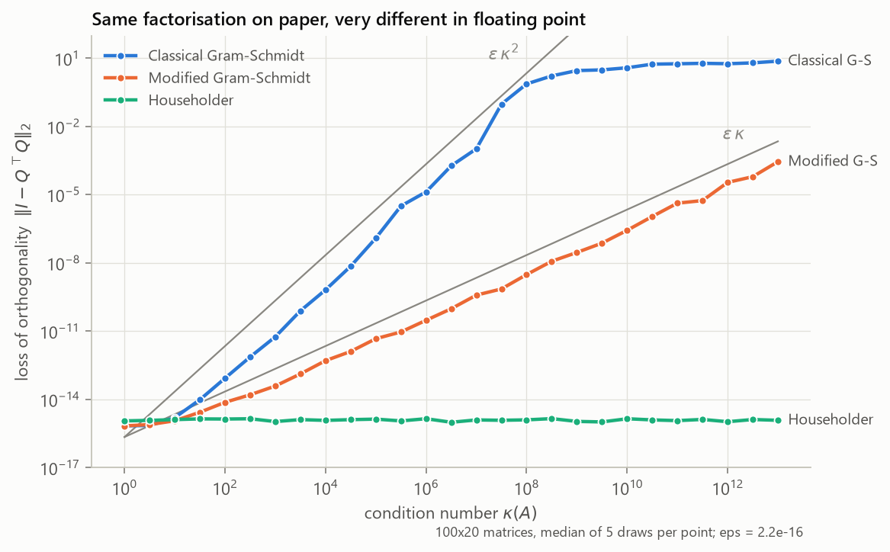
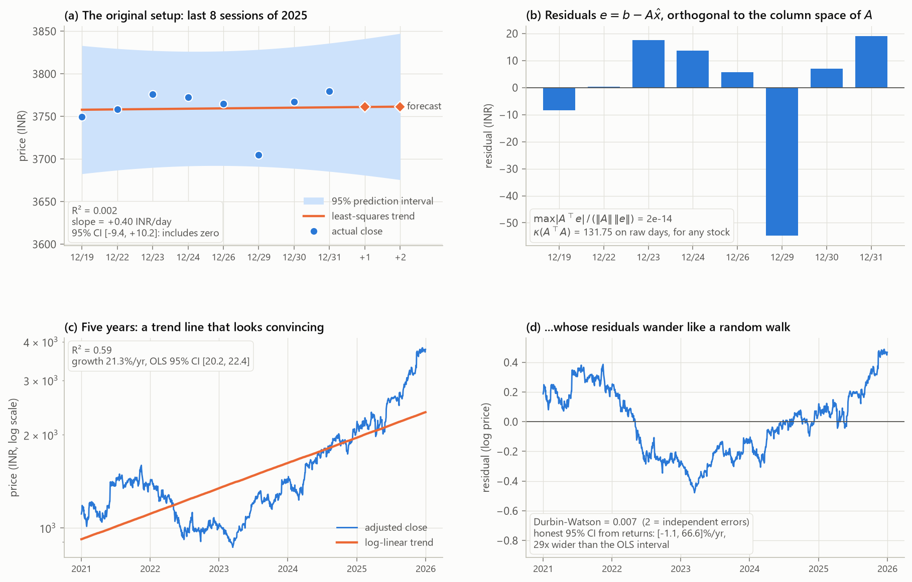

# Spectral Market Lab

[](https://github.com/Shriram60/spectral-market-lab/actions/workflows/ci.yml)

From-scratch numerical linear algebra, applied to the structure of equity markets.

This started as a mini project for *Linear Algebra and Its Applications* (PES University,
2024-25): fit a straight line through 8 days of one stock's prices with the normal
equations. **Phase 1** rebuilds it as a tested library. It has three QR factorisations, a
Jacobi SVD, Cholesky, ridge and LASSO, all written from scratch. It then uses them to ask
the questions the first version skipped: *which solver can you trust, how sure are you,
and does the trend actually predict anything?*

The answers, in short:

| Question | Finding |
|---|---|
| Does the algorithm matter if the maths is the same? | At condition number 10⁸, classical Gram-Schmidt loses **all** orthogonality (‖I − QᵀQ‖ = 0.75), modified Gram-Schmidt loses half its digits (3×10⁻⁹) and Householder stays at machine precision (1×10⁻¹⁵). |
| Normal equations or QR? | The normal equations square the condition number. On raw day numbers they keep fewer than 6 correct digits from a degree-4 trend onwards, and Cholesky breaks down entirely at degree 12. **Rescaling time** cuts the condition number by over 10 orders of magnitude, and after that every solver is accurate. |
| Was the original "98% variance explained" claim right? | No. Those eigenvalues of AᵀA depend only on the day indices and are the same for every stock. The real R² on the 8-day window is **0.002**, and the slope's 95% CI, [−9.4, +10.2] INR/day, includes zero. |
| Can a 5-year trend be trusted? | R² = 0.59 looks convincing, but Durbin-Watson = 0.007: the residuals are a random walk. The OLS confidence interval on annual growth is **29× too narrow**. |
| Does extrapolating the trend predict prices? | **0 of 210** configurations (7 series × 5 windows × 3 degrees × 2 horizons) beat the naive no-change forecast. Directional accuracy is a coin flip (40–55%). |

The last row is the reason for the roadmap below. Time-series extrapolation of a single
price is a dead end, so Phase 2 moves to the *cross-sectional* structure of the market,
which is where linear algebra has real predictive and risk-management power.

---

## Results

### 1. Same factorisation on paper, very different in floating point



All three algorithms compute `A = QR` in exact arithmetic. Classical Gram-Schmidt
projects each column against the *original* vector, so rounding errors compound and the
loss of orthogonality grows like ε·κ². Modified Gram-Schmidt reorders the same arithmetic
to project the *updated* vectors, which improves this to ε·κ. Householder applies exact
orthogonal reflections and stays at ε regardless of conditioning. The measured curves
follow the theoretical slopes. ([`experiments/orthogonality.py`](src/spectral_market/experiments/orthogonality.py))

### 2. The basis matters more than the solver


Polynomial trends of degree 1-14 over one trading year, with known true coefficients:

* **(a) Raw day numbers.** κ(A) reaches 10¹² by degree 5. The normal equations, which work
  with κ(AᵀA) = κ(A)², lose accuracy first, and Cholesky fails outright from degree 12
  (AᵀA is no longer numerically positive definite). QR follows one degree behind. The SVD
  solver truncates singular values below ε·σ_max and returns the minimum-norm solution,
  so its error stays bounded instead of exploding.
* **(b) Time rescaled to [−1, 1].** Every solver stays accurate through degree 14. The
  normal equations still lose about 5 more digits than QR (7×10⁻⁸ vs 8×10⁻¹³), which
  is the κ² penalty in miniature.
* **(c)** The condition numbers behind it: at degree 5, raw 1.9×10¹², rescaled 43,
  Legendre basis 3.3.

### 3. The original project, redone honestly



**(a, b)** The original 8-day setup, pinned to the last 8 sessions of 2025 so it can be
reproduced. The fit is still a projection onto the column space of A (the residual is
orthogonal to it, up to 2×10⁻¹⁴). But the statistics the first version should have
reported tell a different story than its eigenvalue table did:

| | Version 1 claimed | Actually |
|---|---|---|
| Eigenvalues of AᵀA | "dominant pattern in the data" | **[210.40, 1.60] for any stock**. A = [1, t] contains no prices. Their ratio, 131.75, is κ(AᵀA), a measure of numerical sensitivity. |
| Variance explained | ~98% | R² = **0.002** |
| Trend | "clear upward trend" | slope +0.40 INR/day, 95% CI **[−9.35, +10.16]** |
| Day 9 / 10 forecast | point values | 3761 INR, 95% prediction intervals [3681, 3841] and [3676, 3847] |
| Conditioning | not discussed | κ(A) = 11.5 on raw days, **1.53** with time standardised |

**(c, d)** Over 5 years, a log-linear trend gives R² = 0.59 and an OLS estimate of
21.3%/yr with 95% CI [20.2, 22.4]. But the residuals have Durbin-Watson = 0.007: they
wander like a random walk, so the OLS standard errors (which assume independent errors)
are meaningless. Estimating the same drift from daily *returns*, which are close to
independent, gives the honest interval, **[−1.1%, 66.6%]/yr**, which is 29× wider.

### 4. Trend extrapolation vs. a random walk, out of sample


Every configuration was evaluated walk-forward (at each date the model sees only the
past) on 7 series from 2021 to 2025: MUTHOOTFIN, NIFTY 50, RELIANCE, TCS, HDFCBANK, INFY
and ITC. That's 5 look-back windows (8-250 days), degrees 0-2 and 1- and 5-day
horizons, 239,904 forecasts in total. The benchmark is the random walk ("tomorrow
equals today").

* **210 / 210** configurations have higher RMSE than the random walk (median ratio 1.2-7.9×).
* **0 / 210** beat it in a Diebold-Mariano test (Harvey-Leybourne-Newbold correction,
  Newey-West variance for overlapping horizons). All 210 are significantly *worse*.
* Directional accuracy ranges from 40.1% to 54.9%.

**Implementation note: a rolling regression is a linear filter.** Re-index every window
as t = 0..w−1 and the design matrix is the same for all windows. So the h-step forecast is
ŷ = a_hᵀ(AᵀA)⁻¹Aᵀy = **wᵀy** with **w = Q R⁻ᵀ a_h**, computed once from a Householder
QR. The whole backtest is then a single matrix-vector product over a sliding-window view.
Tests check that w reproduces polynomials exactly (Σw = 1, wᵀtᵏ = t_hᵏ).
([`forecast.py`](src/spectral_market/forecast.py))

---

## What's implemented

Everything in `spectral_market.linalg` is written from scratch. NumPy is used for array
arithmetic, never for `qr`, `svd`, `solve`, `cholesky` or `lstsq`. Each routine is
tested against NumPy, SciPy or scikit-learn.

| Module | Algorithm | Notes |
|---|---|---|
| [`triangular.py`](src/spectral_market/linalg/triangular.py) | forward / back substitution | multiple right-hand sides |
| [`cholesky.py`](src/spectral_market/linalg/cholesky.py) | Cholesky | detects loss of positive definiteness |
| [`qr.py`](src/spectral_market/linalg/qr.py) | classical & modified Gram-Schmidt, Householder | compact Householder form: Qᵀb applied in O(mn) without forming Q |
| [`svd.py`](src/spectral_market/linalg/svd.py) | one-sided Jacobi SVD | QR-preconditioned, round-robin "parallel" ordering vectorises each sweep; 1250×100 in ~0.2 s; orthonormal completion for rank-deficient input |
| [`lstsq.py`](src/spectral_market/linalg/lstsq.py) | least squares via normal equations, QR, SVD | SVD path gives the minimum-norm solution for rank-deficient A |
| [`regularized.py`](src/spectral_market/linalg/regularized.py) | ridge (SVD filter factors), GCV, LASSO (coordinate descent) | whole ridge path, effective dof and GCV from one SVD; LASSO optimality certified by KKT conditions |
| [`trend.py`](src/spectral_market/trend.py) | polynomial trends with diagnostics | R², standard errors via R⁻¹, leverage = row norms of Q, prediction intervals, Durbin-Watson |
| [`forecast.py`](src/spectral_market/forecast.py) | walk-forward evaluation | forecast-as-filter, Diebold-Mariano test |

Ridge and LASSO are implemented and verified here. Their main use is in Phase 2, where
there are more correlated features than a polynomial trend can supply.

## Reproduce

```bash
git clone https://github.com/Shriram60/spectral-market-lab.git
cd spectral-market-lab
python -m venv .venv
.venv\Scripts\activate          # Windows
source .venv/bin/activate       # macOS / Linux
pip install -e ".[dev]"

pytest                                  # 74 tests, ~2 s
python -m spectral_market.experiments   # regenerates figures/ and results/ in under 10 s
```

Price data is pinned to 2021-01-01 to 2025-12-31 (1,236 sessions) and cached in `data/`,
so every number above is reproducible offline. Delete a CSV to re-download it with
`yfinance`. Every figure has a JSON twin in `results/` with the underlying numbers. CI
runs lint, tests and the full experiment pipeline on Python 3.10 and 3.12.

## Project structure

```
src/spectral_market/
├── linalg/            from-scratch numerical linear algebra
├── trend.py           trend fitting + diagnostics
├── forecast.py        walk-forward evaluation, Diebold-Mariano
├── data.py            pinned, cached price data
├── plotting.py        shared figure style
└── experiments/       one module per figure (python -m spectral_market.experiments)
tests/                 factorisations, SVD, least squares, trend, forecasting
data/  figures/  results/
```

## Roadmap

- [x] **Phase 1: numerical linear algebra core.** Solvers from scratch, stability
  experiments, honest trend diagnostics, walk-forward evaluation.
- [ ] **Phase 2: spectral structure of the market.** SVD/PCA of the NIFTY 50 returns
  matrix (eigenportfolios, the "market mode"), random matrix theory (Marchenko-Pastur
  noise band, eigenvalue clipping), spectral clustering on the correlation graph's
  Laplacian to recover sectors without labels, and sparse index tracking with LASSO.
- [ ] **Phase 3: use the structure.** Minimum-variance portfolios as a KKT linear
  system, with out-of-sample volatility of the sample covariance vs RMT-cleaned vs
  Ledoit-Wolf. Stretch goal: PCA-residual statistical arbitrage.
- [ ] **Phase 4: dynamic trends.** A Kalman filter (recursive least squares) for a
  time-varying trend, and a hidden Markov model for regime detection.
- [ ] Interactive dashboard.

## Limitations

- Phase 1 results cover 7 Indian series over one 5-year window. The random-walk finding
  is consistent with the efficient-markets literature, but it is not a proof.
- Prices are split- and dividend-adjusted closes from Yahoo Finance. No transaction
  costs are modelled yet, since Phase 1 does no trading.
- The Jacobi SVD is accurate and reasonably fast for matrices up to a few hundred
  columns. It is not a replacement for LAPACK on large problems.
