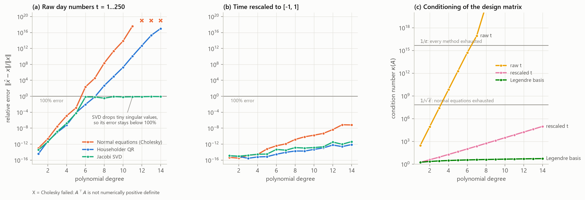
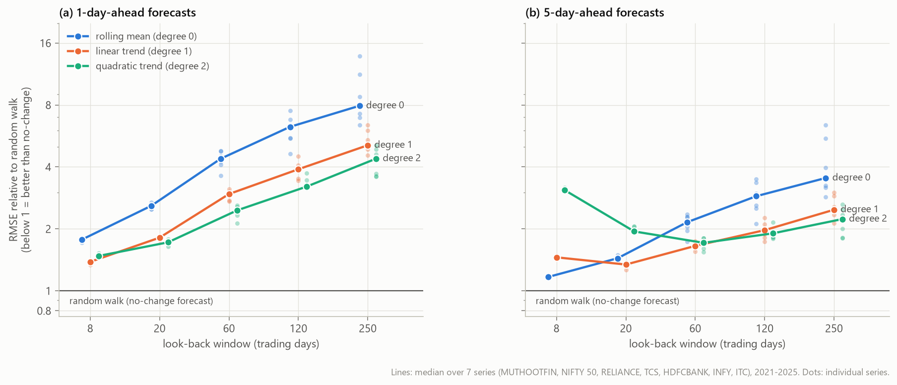
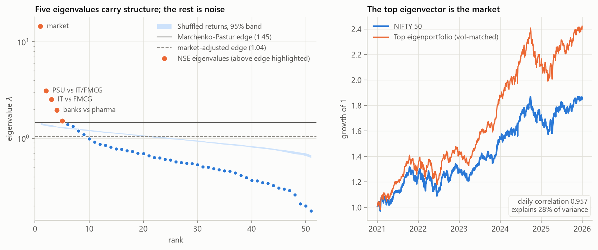
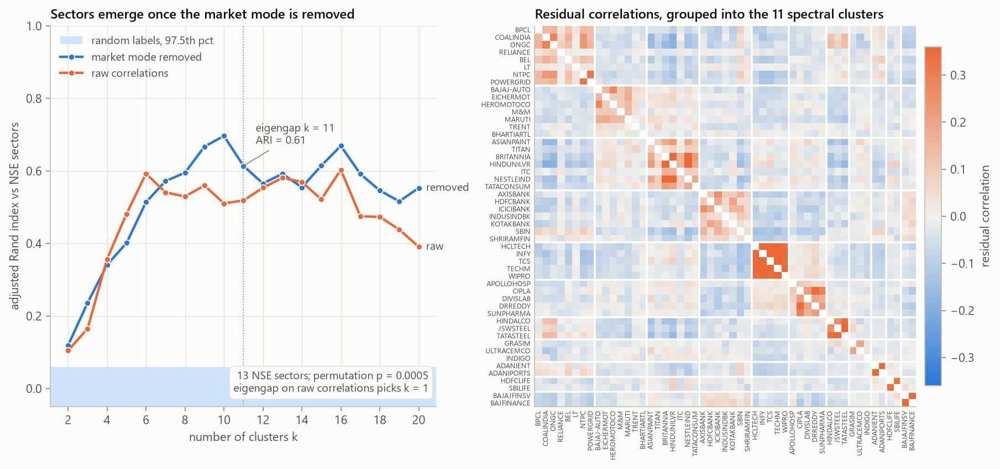
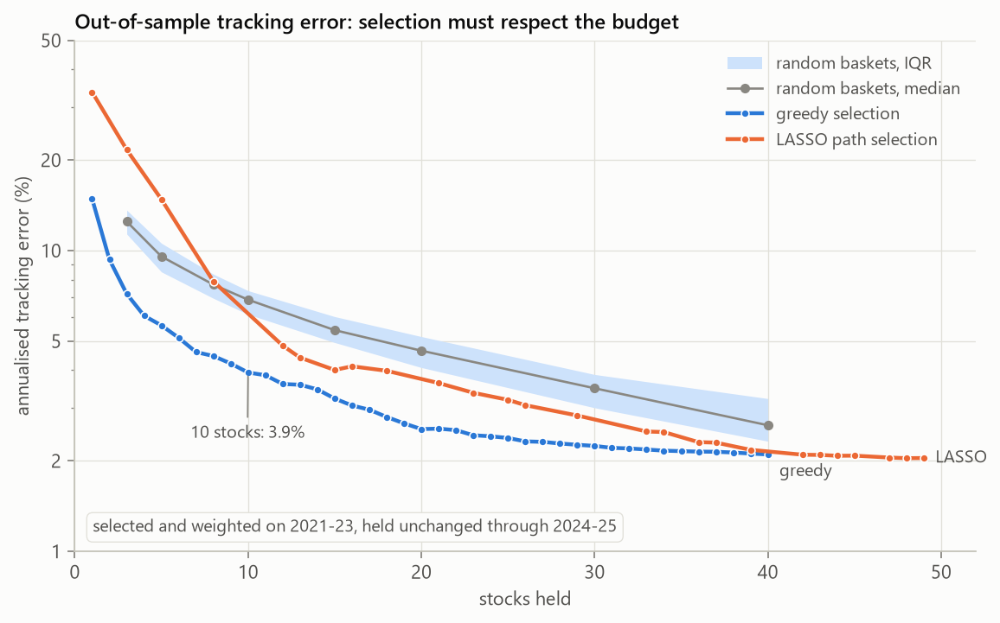
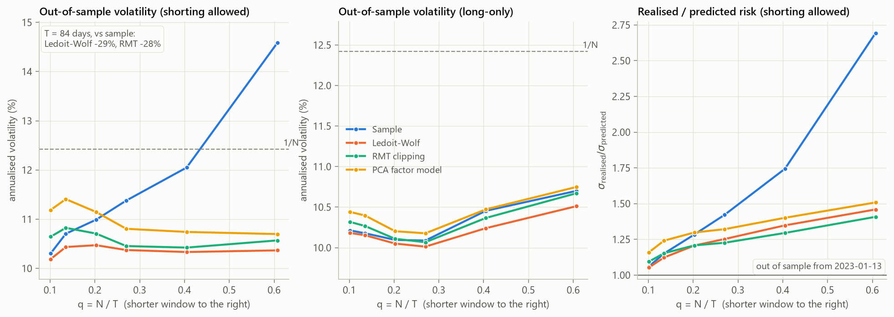
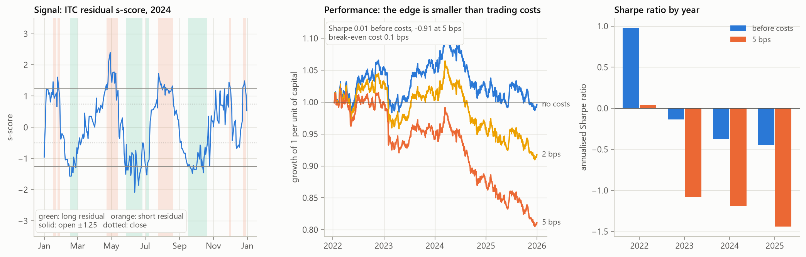
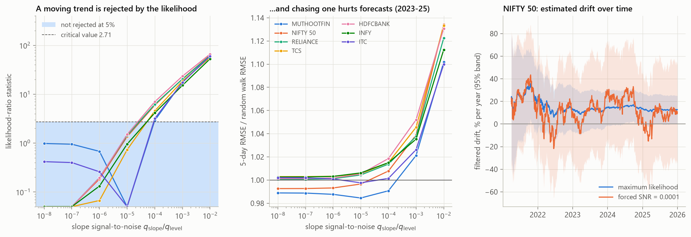
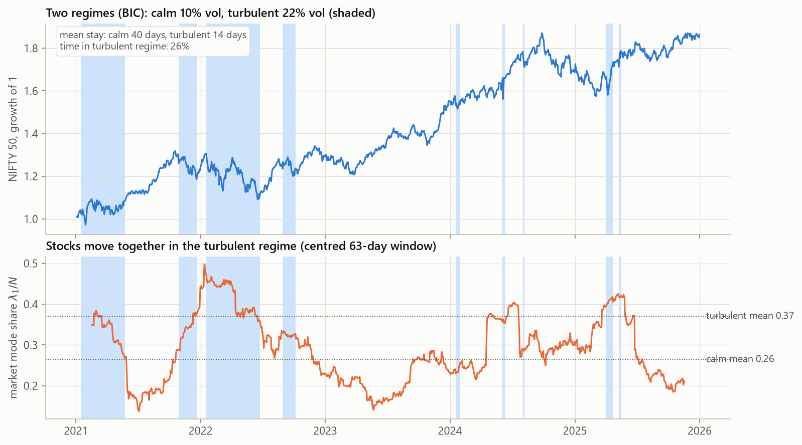

# Spectral Market Lab

[](https://github.com/Shriram60/spectral-market-lab/actions/workflows/ci.yml)

A numerical linear algebra library written from scratch in Python, applied to the
structure of the Indian equity market. It covers matrix factorisations, eigensolvers,
regularised regression, constrained quadratic programming, the Kalman filter and hidden
Markov models. The data is 51 NSE large-cap stocks and the NIFTY 50 index over
2021–2025.

The project asks what linear algebra can and cannot tell you about a market, and it
scores every answer out of sample against a simple baseline with a significance test.
Where a method does not beat its baseline, that is reported as the result.

## Key results

| Question | Answer |
|---|---|
| Does the QR algorithm matter? | At condition number 10⁸, classical Gram-Schmidt loses all orthogonality (‖I − QᵀQ‖ = 0.75). Modified Gram-Schmidt reaches 3×10⁻⁹ and Householder 1×10⁻¹⁵. |
| Normal equations or QR? | On raw time indices the normal equations fall below 6 correct digits at polynomial degree 4, and Cholesky fails at degree 12. Rescaling time to [−1, 1] lowers κ(A) by more than 10 orders of magnitude, and every solver stays accurate through degree 14. |
| Does a fitted price trend predict anything? | No. Across 210 walk-forward configurations (239,904 forecasts) no trend model beats a random walk, and 0/210 are significantly better in a Diebold-Mariano test. |
| How much of the market is noise? | One market mode explains 28.4% of the variance and correlates 0.96 with the NIFTY 50. Only 5 of 51 eigenvalues lie above the Marchenko-Pastur noise edge, or 9 once the market mode is removed. |
| Can sectors be found without labels? | Spectral clustering recovers NSE sectors with adjusted Rand index 0.61 (permutation p = 0.0005). It only works after the market mode is projected out. |
| How few stocks track the index? | A greedily selected 10-stock basket tracks the NIFTY 50 with 3.9% annual tracking error out of sample (2024–2025), better than every one of 200 random 10-stock baskets (median 6.9%). |
| Does cleaning the covariance matrix help? | Yes, when data is scarce. With an 84-day window, Ledoit-Wolf shrinkage cuts the realised volatility of the minimum-variance portfolio from 14.6% to 10.4% (p < 0.001). The gain disappears with long windows or a long-only constraint. |
| Is there a PCA stat-arb edge? | No. Sharpe 0.01 before costs; the strategy breaks even at 0.06 bps per trade, far below any realistic cost. |
| Does a time-varying trend help? | No. The Kalman filter's 5-day forecasts are within 1% of a random walk's RMSE on all 7 series; only 1 of 7 differences is significant at 5%. |
| Are there market regimes? | Yes. A 2-state hidden Markov model (chosen by BIC) separates a calm regime (9.8% volatility, 74% of the time) from a turbulent one (21.7%), and stocks are more correlated in the turbulent regime. As a volatility forecaster it does not beat EWMA. |

## Contents

- [Numerical foundations](#numerical-foundations)
- [Trend fitting and forecasting](#trend-fitting-and-forecasting)
- [Spectral structure of the market](#spectral-structure-of-the-market)
- [Sector discovery by spectral clustering](#sector-discovery-by-spectral-clustering)
- [Sparse index tracking](#sparse-index-tracking)
- [Minimum-variance portfolios and covariance cleaning](#minimum-variance-portfolios-and-covariance-cleaning)
- [PCA statistical arbitrage](#pca-statistical-arbitrage)
- [Kalman filter trend](#kalman-filter-trend)
- [Market regimes with a hidden Markov model](#market-regimes-with-a-hidden-markov-model)
- [Library](#library)
- [Data](#data)
- [Reproducing](#reproducing)
- [Limitations](#limitations)

## Numerical foundations

### QR factorisation stability


Three QR algorithms are run on matrices with prescribed condition numbers from 1 to
10¹³. Loss of orthogonality ‖I − QᵀQ‖₂ follows the theoretical rates: ε·κ² for classical
Gram-Schmidt, ε·κ for modified Gram-Schmidt and ε for Householder reflections.

| Algorithm | ‖I − QᵀQ‖₂ at κ = 10⁸ |
|---|---|
| Classical Gram-Schmidt | 0.75 |
| Modified Gram-Schmidt | 3.1×10⁻⁹ |
| Householder | 1.3×10⁻¹⁵ |

### Least-squares solvers and conditioning



Polynomial trends with known coefficients are fitted over 250 trading days with three
solvers. The normal equations work with κ(AᵀA) = κ(A)² and lose accuracy first: on raw
day numbers their relative error passes 10⁻⁶ at degree 4, against degree 5 for QR and
SVD. The SVD solver truncates singular values below ε·σ_max, so its error stays bounded
on rank-deficient problems. Rescaling the time axis matters more than the choice of
solver: at degree 3, κ(A) drops from 2.4×10⁷ to 8.2, and a Legendre basis keeps κ(A)
below 6 at every degree tested.

## Trend fitting and forecasting

### Diagnostics of a straight-line trend


The original version of this project fitted a line through 8 days of MUTHOOTFIN prices
with the normal equations and read meaning into the eigenvalues of AᵀA. Those
eigenvalues depend only on the day indices, so they are identical for every stock.

| Quantity | Value |
|---|---|
| Eigenvalues of AᵀA, A = [1, t], t = 1..8 | 210.40, 1.60 (fixed by the time index, independent of prices) |
| κ(A), raw / standardised time | 11.48 / 1.53 |
| R², 8 sessions | 0.002 |
| Slope, 95% CI | +0.40 INR/day, [−9.35, +10.16] |
| Day 9 forecast, 95% prediction interval | 3761, [3681, 3841] |
| 5-year growth, OLS 95% CI | 21.3%/yr, [20.2, 22.4] |
| 5-year growth, returns-based 95% CI | 28.4%/yr, [−1.1, 66.6] |

The 5-year log-linear fit has R² = 0.59, which looks convincing, but the residuals have
Durbin-Watson 0.007, i.e. near-unit-root autocorrelation. OLS standard errors are then
invalid. The interval computed from returns is the consistent one, and it is 29× wider.

### Walk-forward evaluation



Seven series (MUTHOOTFIN, NIFTY 50, RELIANCE, TCS, HDFCBANK, INFY, ITC) are forecast
with rolling windows of 8–250 days, polynomial degrees 0–2 and horizons of 1 and 5 days.
Every configuration has a higher RMSE than the random walk (median ratio 1.2–7.9×), and
directional accuracy is 40.1–54.9%.

Rolling least-squares forecasts are computed as a fixed linear filter: ŷ = wᵀy with
w = QR⁻ᵀaₕ, derived once from a Householder QR. The whole backtest is one
matrix-vector product per configuration.

## Spectral structure of the market



PCA is computed from the SVD of the standardised returns matrix (1,235 days × 51 stocks)
rather than by eigendecomposing the correlation matrix, for the same conditioning reason
that QR is preferred to the normal equations.

Random matrix theory gives the null. For N independent series observed T times, the
correlation eigenvalues fill the Marchenko-Pastur interval [(1 − √q)², (1 + √q)²] with
q = N/T = 0.041, so the noise edge is 1.45. The analytic edge is confirmed empirically:
shuffling each stock's returns in time keeps fat tails but destroys co-movement, and the
largest shuffled eigenvalue is 1.45.

| Quantity | Value |
|---|---|
| λ₁ (market mode) | 14.49, 28.4% of variance |
| λ₂, λ₃ | 3.12, 2.52 (6.1%, 5.0%) |
| Eigenvalues above the noise edge | 5 |
| Above the edge after removing the market mode (edge 1.04) | 9 |
| Correlation of PC1 returns with NIFTY 50 | 0.96 |
| Inverse participation ratio of PC1 × N | 1.10 (spread almost evenly over all stocks) |

The eigenportfolios after the market mode read as sector bets:

| Component | Negative end | Positive end |
|---|---|---|
| PC2 | Energy and utilities (COALINDIA, ONGC, NTPC) | IT and FMCG (TCS, INFY, HINDUNILVR) |
| PC3 | IT (HCLTECH, TECHM, INFY) | FMCG (HINDUNILVR, BRITANNIA, NESTLEIND) |
| PC4 | Banks (ICICIBANK, HDFCBANK, BAJFINANCE) | Pharma (CIPLA, DRREDDY, SUNPHARMA) |

## Sector discovery by spectral clustering



Stocks are nodes of a graph weighted by positive residual correlation. The low
eigenvectors of the normalised Laplacian L = I − D⁻¹ᐟ²WD⁻¹ᐟ² embed the stocks, and k-means
groups them. The number of clusters comes from the largest eigengap. NSE sector labels
are never used as inputs, only to score the result.

- **With the market mode projected out**, the eigengap chooses k = 11 and the clusters
  match the 13 NSE sectors with adjusted Rand index 0.61. The 97.5th percentile of a
  2,000-permutation null is 0.06, so p = 0.0005.
- **Without removing the market mode**, the eigengap chooses k = 1: the market factor
  correlates everything with everything and hides the sector structure.

| Majority sector | Purity | Members |
|---|---|---|
| Financials | 100% | HDFCBANK, ICICIBANK, SBIN, KOTAKBANK, AXISBANK, INDUSINDBK, SHRIRAMFIN |
| IT | 100% | TCS, INFY, HCLTECH, WIPRO, TECHM |
| Healthcare | 100% | SUNPHARMA, CIPLA, DRREDDY, DIVISLAB, APOLLOHOSP |
| Metals | 100% | TATASTEEL, JSWSTEEL, HINDALCO |
| Financials | 100% | HDFCLIFE, SBILIFE |
| Financials | 100% | BAJFINANCE, BAJAJFINSV |
| Auto | 71% | MARUTI, M&M, BAJAJ-AUTO, EICHERMOT, HEROMOTOCO, TRENT, BHARTIARTL |
| FMCG | 71% | HINDUNILVR, ITC, NESTLEIND, BRITANNIA, TATACONSUM, ASIANPAINT, TITAN |
| Cement | 67% | ULTRACEMCO, GRASIM, INDIGO |
| Energy | 50% | RELIANCE, ONGC, BPCL, COALINDIA, NTPC, POWERGRID, LT, BEL |
| Metals | 50% | ADANIENT, ADANIPORTS |

The mismatches make economic sense: insurers and the Bajaj finance companies split off
from the banks, energy merges with utilities and capital goods, and the two Adani
companies form their own group.

## Sparse index tracking



How few stocks does it take to replicate the NIFTY 50? Baskets are chosen on 2021–2023
and held unchanged through 2024–2025. Weights solve the long-only, fully invested
tracking problem min ‖r_index − Rw‖² subject to w ≥ 0, Σw = 1, a quadratic program on the
probability simplex solved exactly by a primal active-set method.

An L1 penalty cannot create sparsity here because ‖w‖₁ = 1 on the simplex, so selection
and weighting are separated. Two selection rules are compared: the order in which stocks
enter a long-only LASSO path, and greedy forward selection that re-solves the QP for
every candidate. The benchmark for each basket size is 200 random baskets of that size
weighted by the same QP, which isolates the value of selection.

| Basket | Stocks | Tracking error 2021–23 | Tracking error 2024–25 |
|---|---|---|---|
| Greedy | 5 | 5.1% | 5.6% |
| Greedy | 10 | 3.3% | 3.9% |
| LASSO | 5 | 15.5% | 14.8% |
| LASSO | 8 | 9.1% | 7.9% |
| Random, median | 10 | | 6.9% |
| All stocks | 49 non-zero | | 2.0% |

Greedy selection beats every random basket at every size tested (3 to 40 stocks). LASSO
ordering is worse than random at small sizes because it picks high-variance stocks
(BAJFINANCE, INDUSINDBK) instead of the large index weights. The greedy 10-stock basket
is HDFCBANK, RELIANCE, ICICIBANK, TCS, INFY, ITC, GRASIM, LT, MARUTI and SBILIFE.

## Minimum-variance portfolios and covariance cleaning



The global minimum-variance portfolio solves min wᵀΣw subject to 1ᵀw = 1. Its KKT system
gives w = Σ⁻¹1 / (1ᵀΣ⁻¹1), computed with one Cholesky factorisation and two triangular
solves. The long-only version adds w ≥ 0 and uses the simplex QP.

The optimiser loads on the smallest-eigenvalue directions of Σ, which is exactly where
the sample covariance underestimates risk. Four estimators are compared:

- **Sample covariance**
- **Ledoit-Wolf shrinkage** toward a scaled identity, with the optimal intensity in
  closed form
- **RMT clipping**: correlation eigenvalues below the Marchenko-Pastur edge are replaced
  by their average
- **PCA factor model**: the top eigen-directions plus a diagonal idiosyncratic part, with
  the number of factors set by the noise edge in each window

Estimation windows range from 84 to 504 days (q = N/T from 0.61 to 0.10). Portfolios are
rebalanced every 21 days and scored on the same out-of-sample period, 2023-01-13 to
2025-12-31. Differences in realised variance use a Diebold-Mariano test on squared daily
returns. For reference, an equally weighted portfolio has 12.4% volatility.

| Window (days) | Sample | Ledoit-Wolf | RMT clipping | PCA factor |
|---|---|---|---|---|
| 84 | 14.6% | **10.4%** | 10.6% | 10.7% |
| 126 | 12.1% | **10.3%** | 10.4% | 10.7% |
| 252 | 11.0% | **10.5%** | 10.7% | 11.2% |
| 504 | 10.3% | **10.2%** | 10.6% | 11.2% |

*Annualised out-of-sample volatility, shorting allowed.*

- With short windows, every cleaned estimator beats the sample covariance by 27–29%
  (p < 0.001). Ledoit-Wolf is the best at every window.
- At 84 days the sample portfolio's realised volatility is 2.7× what it predicts for
  itself. Ledoit-Wolf brings that bias ratio down to 1.5 and cuts turnover from 3.7 to
  1.0 per rebalance.
- With 504 days of data the gap shrinks to 1%, and RMT clipping and the factor model
  become slightly worse than the sample.
- With a long-only constraint all four estimators land within 2% of each other
  (10.0–10.8%). The constraint already acts as a regulariser, so cleaning adds little.

## PCA statistical arbitrage



This is the Avellaneda & Lee (2010) strategy. Each stock's return is regressed on the
market's eigenportfolios, and the cumulative residual is modelled as an Ornstein-Uhlenbeck
process estimated from an AR(1) fit. The s-score (distance from equilibrium, in
equilibrium standard deviations) opens a position above 1.25 and closes it at 0.75 or
0.5, and every position is hedged with its factor exposure. All parameters are the
paper's (252-day PCA window refit every 21 days, 60-day regression window,
mean-reversion time under 30 days), so nothing is tuned on this data and the whole
2022–2025 period is out of sample.

| One-way cost | Annual return | Volatility | Sharpe | Max drawdown |
|---|---|---|---|---|
| 0 bps | +0.1% | 5.7% | 0.01 | 11.6% |
| 2 bps | −2.0% | 5.7% | −0.36 | 14.6% |
| 5 bps | −5.2% | 5.7% | −0.91 | 21.3% |
| 10 bps | −10.5% | 5.7% | −1.83 | 35.2% |
| NIFTY 50 buy and hold | +10.5% | 13.5% | 0.77 | 16.5% |

The strategy holds about 18 positions with 42% daily turnover and uses 5–7 factors per
refit. It made money before costs only in 2022 (Sharpe 0.98), and the break-even cost is
0.06 bps per unit traded. The mean-reversion signal documented for US equities in
1997–2007 does not survive on NSE large caps in 2022–2025.

## Kalman filter trend



A straight-line trend assumes one level and slope for the whole sample. The local linear
trend model lets both drift as hidden states:

```
y_t     = level_t + e_t
level_t = level_{t-1} + slope_{t-1} + u_t
slope_t = slope_{t-1} + v_t
```

The Kalman filter is the exact Bayesian update of the state one observation at a time.
With zero state noise it reduces to recursive least squares and reproduces the OLS line.
Noise variances are fitted by maximum likelihood, and the Rauch-Tung-Striebel smoother
gives the two-sided estimate.

- **Is the slope time-varying?** The slope's signal-to-noise ratio is fixed on a grid
  from 10⁻⁸ to 10⁻² and the remaining variances are profiled out. A likelihood-ratio
  test rejects every SNR ≥ 10⁻⁴ for all seven series, so the best-fitting slope is
  effectively constant.
- **Does it forecast?** Fitted on 2021–2022 and run causally through 2023–2025, the
  5-day forecasts have RMSE 0.99–1.01× the random walk's. MUTHOOTFIN shows a 1.1%
  improvement (p = 0.02); with seven tests this is consistent with chance.
- **Trend-following is costly.** On the NIFTY 50, forcing a trend-following SNR of 10⁻⁴
  widens the standard error of the final annual slope from 6.3% to 22.3%.

## Market regimes with a hidden Markov model



A Gaussian hidden Markov model of daily NIFTY 50 returns is fitted with Baum-Welch (EM),
using scaled forward-backward recursions so nothing underflows. BIC selects two regimes
over one or three.

| Regime | Annual volatility | Annual mean return | Mean stay | Share of time | Mean λ₁/N |
|---|---|---|---|---|---|
| Calm | 9.8% | +25.3% | 40 days | 74% | 0.26 |
| Turbulent | 21.7% | −23.2% | 14 days | 26% | 0.37 |

The regimes connect back to the spectrum. The market-mode share λ₁/N of a rolling 63-day
correlation matrix rises from 0.26 in the calm regime to 0.37 in the turbulent one
(correlation 0.55 with the turbulent indicator). Stocks move together when the market is
stressed, which is exactly when diversification is needed most.

As a one-day volatility forecaster (fitted on 2021–2022, filtered causally through
2023–2025, scored by QLIKE), the HMM is statistically tied with EWMA (p = 0.69). Both
beat a 21-day rolling variance (p = 0.003).

## Library

Every factorisation, eigensolver and optimiser is written from scratch. NumPy is used for
array arithmetic, and SciPy only for distributions and one Nelder-Mead likelihood
maximisation. Each routine is tested against NumPy, SciPy or scikit-learn.

| Module | Contents |
|---|---|
| `linalg/triangular.py` | Forward and back substitution |
| `linalg/cholesky.py` | Cholesky factorisation with positive-definiteness detection |
| `linalg/qr.py` | Classical and modified Gram-Schmidt; compact Householder QR |
| `linalg/svd.py` | One-sided Jacobi SVD with QR preconditioning and round-robin ordering |
| `linalg/eigen.py` | Symmetric eigendecomposition by cyclic Jacobi rotations |
| `linalg/lstsq.py` | Least squares via normal equations, QR and SVD (minimum-norm) |
| `linalg/regularized.py` | Ridge (SVD filter factors, GCV); LASSO (coordinate descent, paths, KKT check, non-negative variant) |
| `optimize.py` | Exact active-set QP on the probability simplex with KKT certification |
| `spectral.py` | PCA via SVD, Marchenko-Pastur law, inverse participation ratio, market-mode removal, normalised Laplacian, k-means++, adjusted Rand index |
| `covariance.py` | Sample, Ledoit-Wolf, RMT-clipped and PCA factor covariance |
| `portfolio.py` | Minimum-variance weights (KKT with Cholesky, long-only QP) and rolling backtests |
| `tracking.py` | Simplex tracking weights, LASSO and greedy selection paths, random baskets |
| `statarb.py` | Ornstein-Uhlenbeck fitting, s-scores and the factor-hedged stat-arb backtest |
| `kalman.py` | Local linear trend Kalman filter, RTS smoother, maximum-likelihood fitting |
| `hmm.py` | Gaussian HMM: scaled forward-backward, Baum-Welch, Viterbi, BIC, variance forecasts |
| `trend.py` | Polynomial trends: R², standard errors, leverage, prediction intervals, Durbin-Watson |
| `forecast.py` | Walk-forward evaluation, Diebold-Mariano test with HLN correction |
| `universe.py`, `data.py` | Stock universe, sector labels, cached price loading |

The test suite in `tests/` has 100 tests.

## Data

- **Universe**: 51 large-cap NSE stocks drawn from recent NIFTY 50 constituents with a
  complete price history over 2021–2025 (TATAMOTORS, LTIM, ETERNAL and JIOFIN are
  excluded for listing, delisting or demerger reasons), plus the NIFTY 50 index.
- **Prices**: split- and dividend-adjusted daily closes from Yahoo Finance,
  2021-01-01 to 2025-12-31, cached in `data/` so every result reproduces offline.
- **Sector labels**: hand-assigned following NSE sector names and used only to evaluate
  the unsupervised methods.

## Reproducing

```bash
git clone https://github.com/Shriram60/spectral-market-lab.git
cd spectral-market-lab
python -m venv .venv && source .venv/bin/activate   # Windows: .venv\Scripts\activate
pip install -e ".[dev]"
pytest
python -m spectral_market.experiments
```

Each experiment can also be run on its own, for example
`python -m spectral_market.experiments.min_variance`. Every figure in `figures/` has a
matching JSON file in `results/` holding the numbers quoted above. CI runs linting, the
test suite and the full experiment pipeline on Python 3.10 and 3.12.

### Website

`site/` is a static, interactive version of these results. Open `site/index.html` in a
browser, or serve the folder with any static host. `site/data.js` bundles the JSON results
with the time series the charts need; regenerate it after rerunning experiments with
`python site/build_data.py`.

## Limitations

- Results cover Indian large caps over a single five-year period.
- The universe uses today's index constituents over a past window, which introduces
  survivorship bias.
- Backtests charge proportional costs only, with no market impact or borrow costs.
- The Jacobi SVD and eigensolver target matrices of up to a few hundred columns and are
  not a substitute for LAPACK at scale.

---

Originally a course project for *Linear Algebra and Its Applications*, PES University
(2024–25).
